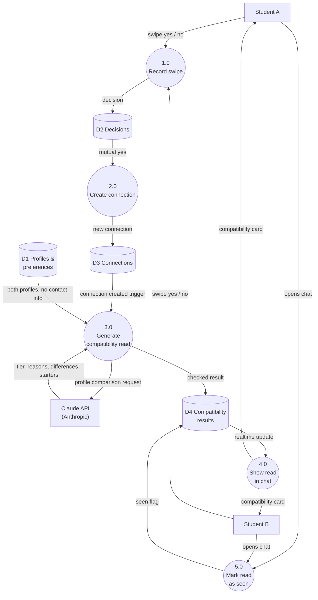

# Dwellr

Roommate matching for BYU students in Provo and Utah Valley.
Module 5 project, Section 2, Group 8.

## App Summary

Many students come to BYU without a roommate lined up, whether they're new to Provo, transferring, or just don't know anyone yet. Finding someone compatible through random posts or word of mouth is hit-or-miss, and living with the wrong person can make the school year miserable. Dwellr helps BYU students in Provo and Utah Valley find roommates they're actually likely to get along with. Students create a profile with their interests, living habits, and housing preferences, then swipe through other students' profiles. When two students both swipe right, they're matched and can message each other in the app. From there they can decide whether they'd really want to live together. Dwellr works for students looking for their first roommate and for those who want a new one.

## Tech stack

**We chose a backend as a service: Supabase.** It connects to a front end we write ourselves in plain HTML, CSS, and JavaScript. GitHub stores our code and can host the site with GitHub Pages.

### Why it fits our team

- **We keep the screens we already designed.** Our pages are plain HTML, CSS, and JavaScript. Supabase has a JavaScript library we add with one script tag, so we didn't have to rebuild the site in a framework.
- **It covers our must-have features.** Each must-have in our PRD maps to something Supabase already provides (see the table below), so we spend our time on the matching experience instead of building login systems and servers.
- **Real-time chat without our own server.** Supabase Realtime delivers new messages and new matches to the other person as they happen.
- **The database enforces our safety rules.** Row Level Security rules live inside the database, such as "only two connected students can message each other" and "only you can see your phone number." They hold even if someone tries to get around the website.
- **We still learn real database design.** Supabase runs on PostgreSQL, so we designed real tables from our ERD and wrote SQL.

## How our features map to Supabase

| Feature (from our PRD) | Supabase piece |
|---|---|
| Sign up and log in (email and password) | Supabase Auth |
| Profiles, interests, living and housing preferences | `profile`, `interest`, `user_interests`, `living_preferences`, `housing_preferences` tables |
| Edit Profile | `update_my_profile` database function allows students to update their personal information, interests, living habits, and housing preferences without creating a new account |
| Profile photos (up to 5) | `photos` table and the `profile-photos` storage bucket |
| Swiping right or left | `decision` table stores swipe decisions and timestamps |
| 14-day decline feature | The `get_deck` function hides declined profiles for 14 days before allowing them to reappear in the swipe deck. If declined again, the 14-day timer resets |
| Connection requests inbox | Yes decisions on you that you haven't answered |
| Mutual matching | A database trigger creates a `connections` row when both students say yes |
| Planning to Room Together | Each matched student can confirm or withdraw plans to live together. Supabase stores each confirmation separately in the `connections` table using `user_1_plan_at` and `user_2_plan_at`. The `set_roommate_plan()` RPC updates the confirmation, and both students must confirm before the match is marked as planning to room together. Confirmations are cleared when students unmatch. |
| Messaging between matched students only | `messages` table, Realtime, and Row Level Security |
| Unmatch | Sets the connection to `unmatched`, deletes the chat for both, and blocks new messages |
| Close account | Deletes the student's photos, then their account and all of their rows |
| Report a student | `reports` table; students can file reports but only our team can read them. Once you report someone, they never show up for you again: they're gone from your Find Roommates deck (even after the 14-day reset) and your requests, and you can never be matched. Reporting a match unmatches you automatically, but the messages are kept for our team to review. The reported student isn't told |
| Disable after 3 reports | A database trigger permanently disables an account once 3 different students have reports about them that our team hasn't dismissed. Disabled students only see an "account disabled" screen and are hidden from everyone. Track reports in Table Editor → `report_summary` |
| Pause account | `paused_at` column on `profile` and the `set_paused` function. Paused students are hidden from Find Roommates and other students' requests, and they can't swipe or answer requests. Their connections and chats keep working, and nothing is deleted. Unpause anytime from Settings. The Pause dialog lists exactly what changes and what still works, and a banner on Messages reminds paused students that messaging still works |
| AI compatibility read | A database trigger calls the `generate-compatibility` Edge Function when two students connect. It asks Claude (Anthropic's AI) to compare their profiles and saves the result to `compatibility_results`. Both students see it as a card at the top of their chat. See [AI compatibility read](#ai-compatibility-read) below |

Not built yet: the Blocked and Archives pages from Settings.

## AI compatibility read

When two students connect, Dwellr uses AI to write them a short compatibility read: how well their living habits line up, what's worth talking about before signing a lease, and a few conversation starters. It's meant to help two people who already said yes to each other have a better first conversation, not to decide for them.

### What students see

- A **Compatibility read** card at the top of their chat with a tier (**Strong match**, **Good match**, or **Worth a conversation**), then **Why this could work**, **Worth talking about**, and **Conversation starters**.
- Tapping a conversation starter puts it in the message box, ready to edit or send.
- Right after a match, the chat says "Writing your compatibility read…" and the card appears on its own a few seconds later (Supabase Realtime), with no refresh.
- A **New read** badge in Messages until the student opens that chat. After that, the card starts folded up to one line.
- Both students see the same read, written to both of them ("you both…"). Differences are described without saying who answered what, for example "you have different expectations about weekend guests."
- If the AI is unavailable, the chat says so and works normally. The feature never blocks two students from talking.

### How the automation works

1. Two students both swipe right, and our matching trigger creates a row in `connections`.
2. A second trigger, `request_compatibility_read`, uses Supabase's `pg_net` extension to call our `generate-compatibility` Edge Function in the background, so matching never waits on the AI.
3. The Edge Function loads both students' living preferences, housing preferences, interests, first names, and intros. It never sends last names, phone numbers, emails, ages, or genders.
4. It sends them to the **Claude API** (model: Claude Haiku 5.5) and requires the answer in a fixed format: a tier, 1–3 reasons, 0–2 differences, and 1–3 conversation starters.
5. It checks the answer (a valid tier and all required parts, with overly long items trimmed) and saves it to `compatibility_results`.
6. Realtime pushes the new row to both students' browsers, and `app.js` shows the card.

**Why the AI step isn't a pass-through:** Claude reasons over two profiles at once. It weighs which differences actually matter for living together (cleanliness, sleep, guests, budget, move-in timing), picks a tier, explains it, and writes conversation starters specific to that pair. The result is saved as structured data and used by the app, not just forwarded.

**Safety and cost:**
- Only the two students in a connection can read their result (Row Level Security), and it's hidden if either student is disabled. Students can't create or edit results; only the Edge Function can write them.
- Each connection gets at most one AI call. The function skips connections that already have a read, and a pair that unmatches and reconnects keeps their original read.
- If Claude is briefly overloaded, the function retries once. If it still fails, nothing is saved.
- Each read costs a small fraction of a cent. The Claude API key is stored as a Supabase secret (`ANTHROPIC_API_KEY`), never in the website code.

### Level 1 Data Flow Diagram

Circles are processes, cylinders are data stores, and rectangles are external entities.

## Database design (ERD)

## Files

| File | What it does |
|---|---|
| `index.html` | All nine screens |
| `styles.css` | The design |
| `app.js` | How the screens work |
| `db.js` | Every call to Supabase |
| `config.js` | Our Supabase project URL and publishable key |
| `supabase/schema.sql` | Creates the tables, security rules, matching trigger, photo storage, and realtime |
| `supabase/reset.sql` | Removes everything `schema.sql` created so it can be run again |
| `supabase/functions/generate-compatibility/index.ts` | The Edge Function that writes the AI compatibility read |
| `add-compatibility-results.sql`, `add-compatibility-trigger.sql` | One-time scripts that added the AI compatibility read to our existing project (already run; `schema.sql` includes the same changes) |

## Setting up Supabase

Already done for our project. To set up a new one:

1. Create a project at [supabase.com](https://supabase.com). Leave the Data API turned on.
2. Open **SQL Editor**, paste all of `supabase/schema.sql`, and click **Run**. Run it once.
3. Go to **Authentication → Sign In / Providers** and turn off **Confirm email** while we're testing. Otherwise every sign-up needs an email confirmation, and Supabase's built-in email service only sends a few emails per hour.
4. Copy the **Project URL** and **publishable key** from **Settings → API Keys** into `config.js`.
5. For the AI compatibility read: create an API key in the [Claude Console](https://platform.claude.com), then in Supabase go to **Edge Functions → Secrets** and add it as `ANTHROPIC_API_KEY`. Deploy `supabase/functions/generate-compatibility/index.ts` as an Edge Function named `generate-compatibility` with **Verify JWT** turned off (the database calls it, not a logged-in student). If you use a new project, change the project URL in `request_compatibility_read()` in `schema.sql`.

The publishable key is safe to commit to GitHub because the security rules decide what it can do. Never put the secret key (`sb_secret_...`), the `service_role` key, or the database password in this repo.

## Running the site

**On GitHub Pages:** In the repo, go to **Settings → Pages**, set the source to **Deploy from a branch**, choose `main` and `/ (root)`, and save. The site will be live at `https://ehess29.github.io/Dwellr/` within a few minutes. Then, in Supabase, go to **Authentication → URL Configuration** and set the **Site URL** to that address.

**On your computer:** Open the folder in VS Code and use the Live Server extension, or open `index.html` in a browser. The site needs an internet connection because it loads the Supabase library and talks to our project.

## Verifying the Vertical Slice

Our working button is the **Create Profile button** on a student's profile card. After entering in all of your information and interests. You should be able to press "Create Profile" which will save all of your information into our database (supabase). You should be able to confirm your changes by signing in using your email and password.
## How did you hear about us?

The sign-up page asks students an optional question: "How did you hear about our website?" They can pick Friend or roommate, Social media, BYU class or club, Flyer or poster, Search engine, or Other. Answers are saved to the private `heard_from` column on the `profile` table, which other students can't read. They don't show on anyone's profile. Our team can see the results in Supabase under Table Editor → `profile`. To count them, run this in SQL Editor:

    
